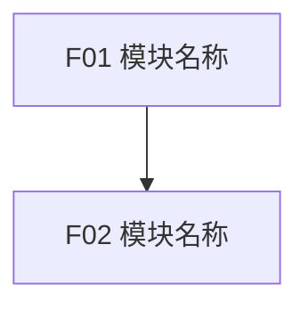
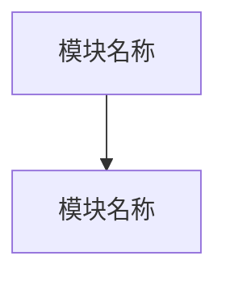

# PRD Make

## 默认开发执行策略：ChatGPT Chat First（2026-10-24 更新）

> **用户已确认的新规则：开发与测试优先在 ChatGPT 普通聊天中完成；只有确实需要时才使用 ChatGPT Work；通过验证后才部署到 ChatGPT Sites。** 此规则适用于新项目和既有项目，并覆盖本 Skill 中任何“默认先交给 Work 开发”的旧建议；不覆盖用户针对单次任务的明确指令。

1. **规划与设计优先 Chat**：需求澄清、PM/PRD、架构讨论、UI 设计、代码方案和审查优先在普通聊天完成。Web UI 默认优先评估 [shadcn/ui](https://ui.shadcn.com/) 和兼容的 Tailwind CSS；不适用时解释原因。
2. **开发优先 Chat**：先使用当前聊天实际可用的工具、连接器及代码能力推进实现、修复与迭代。能在 Chat 完成的，不因任务属于“开发”就主动转交 Work；但不得假设 Chat 一定具备本地仓库写入、终端或运行时能力。
3. **测试优先 Chat**：先在聊天环境中进行可实际执行的验证、代码审查和回归检查。区分 `实际执行并通过`、`执行失败`、`仅静态审查`、`测试方案未执行`；不得将生成代码或建议测试命令称为已测试通过。
4. **仅在必要时使用 Work**：当需要的本地文件/仓库编辑、浏览器交互、运行命令、端到端测试或部署无法由当前聊天工具完成时，才将**最小必要范围**交给 Work 或其他具备权限的执行端。Work 只处理尚未完成的步骤，不重复已验证工作；遵守当前平台的工具路由限制。
5. **GitHub 源码管理**：优先用 GitHub 保存与核对代码、PRD、Commit、PR、测试证据；提交或合并不等于已发布。未真正写入或验证时标记未完成。
6. **Sites 最后部署**：开发完成且必要测试有真实通过证据后，才进入 ChatGPT Sites 部署。先验证 Sites 技术兼容性；更新既有项目时保留原 Site、URL、数据、权限和配置，必要时准备回滚与取得授权；部署后实际验证运行状态。
7. **阻塞处理**：若聊天无法执行必要测试或缺乏真实环境，明确列出缺口；不可因“Chat 优先”而跳过测试或假称具备执行能力。必要时按上述最小范围升级到 Work，再部署。

**默认顺序：** PM Make → PRD Make → shadcn/ui（适用时）→ Chat 开发 → Chat 测试与审查 → GitHub 同步与核验 → Sites 部署 → 上线验证。Work 不是默认阶段，而是按需的执行补充。


## 默认 Web UI 与发布平台（2026-10-21 新增）

> 本节适用于**新开发的 Web 项目**；如果用户明确指定其他 UI 技术、平台，或既有项目已有经确认的技术决策，以用户明确要求和项目既定约束为准。不要把“默认优先”理解成无条件强制。

- **UI 首选**：优先评估并使用 [shadcn/ui](https://ui.shadcn.com/) 的适用组件，配合与项目兼容的 Tailwind CSS；优先复用组件而非重复造轮子，保持一致的视觉规范、响应式布局、键盘操作和无障碍体验。
- **适用性检查**：确认前端框架、组件依赖、构建方式、许可、维护成本及既有设计系统是否兼容。若不适合，说明原因、影响与替代方案，不未经确认更换既有项目 UI 技术栈。
- **默认发布目标**：新 Web 项目优先规划发布到 **ChatGPT Sites**；开发前实际核实目标 Sites 环境对框架、构建产物、路由、API、数据库、鉴权、环境变量、密钥、持久化及自定义域名等能力的支持。未经验证不得承诺某项 Sites 能力可用。
- **源码管理**：优先将 GitHub 作为源码与版本追踪来源；项目若有已确认的其他仓库策略，遵循既有约定。
- **部署边界**：规划、提交、合并、测试、Sites 部署、上线验证是不同阶段；只有真实执行且有证据时才标记完成。需要发布权限或操作工具时，应说明实际能力边界，不能将生成部署指令等同于已部署。
- **更新现有 Site**：默认沿用现有 Site 与 URL，保护生产数据、权限、配置、Secrets 和既有功能；破坏性更改、数据清空或高风险生产发布需明确授权及回滚方案。
- **项目记录**：在产品定型稿、PRD、技术方案或交接指令中，分别注明 UI 选择、Sites 可行性检查结果、尚未验证的限制及实际发布状态。

**本 Skill 的具体应用：**PRD Make 应把已确认的 UI 规范、关键页面的 shadcn/ui 组件映射、响应式及无障碍验收、Sites 环境约束与部署验收写入相应模块；未确认的兼容性问题进入待决策事项。

## 1. 目标

PRD Make 用于从冻结版产品定型稿（Product Shipping Brief）生成面向人类研发团队的完整 PRD。

PRD 是给产品、UI、研发、QA 和落地团队使用的原子化、可评审文档，不是给 AI Coding 直接消费的唯一输入。

本 Skill 不是一次性生成提示词。必须先完成模块规划并取得用户确认，再按照当前 PRD 模板逐段、逐模块追加已确认内容，同时持续维护评审记录、追加日志和待决策事项。

## 2. 项目工作区

不要创建 `skills/` 或 `templates/` 文件夹作为产品项目内容。

PRD 项目工作区应与 PM Make 的产品工作区保持一致：

```text
<ProductName>/
├── 01-产品定义/
│   ├── 01-基本描述.md
│   ├── 02-JTBD场景.md
│   ├── 03-范围边界.md
│   ├── 04-页面流程.md
│   ├── 05-开放问题.md
│   └── 06-最终定型稿.md
│
├── 02-PRD/
│   ├── PRD文档.md
│   ├── 模块规划.md
│   ├── 待决策事项.md
│   └── 追加日志.md
│
├── 03-Prototype/
├── 04-Development/
└── 05-Release/
```

PRD Make 主要读写 `01-产品定义/06-最终定型稿.md` 和 `02-PRD/`。

如果 GitHub 和 Google Drive 均已连接：
- 保持产品目录和文件命名一致。
- 不创建额外的 `skills/`、`templates/` 文件夹。
- Skill 内置的模板定义用于生成 `02-PRD/` 下的实际文件。
- 不要把 Skill 文件复制到产品工作区。
- 若未连接外部系统，不得声称已经写入 GitHub 或 Google Drive。

## 3. 必需输入

冻结版产品定型稿是主要事实来源。

如果用户没有提供冻结版定型稿：
1. 先索取其位置或内容；或
2. 建议切换到 PM Make 完成产品定型。

可运行原型、Demo 记录、截图、会议纪要、用户补充说明只能作为辅助证据。

如果辅助材料与已确认定型稿冲突：
- 不自行选择。
- 记录冲突。
- 以用户最新明确确认的结论为准。

开始写作前至少获得或确认：
- 冻结版产品定型稿及其来源。
- 用户补充的范围、约束、优先级或业务规则。
- 可用于理解页面、流程、状态、权限和数据对象的辅助材料（如有）。
- 用户指定的公司 PRD 模板（如有）。
- PRD 工作区路径；没有时创建/使用 `<ProductName>/02-PRD/`。

## 4. 初始化

在 `02-PRD/` 创建或复用：

- `PRD文档.md`
- `模块规划.md`
- `待决策事项.md`
- `追加日志.md`

初始化时：
- 可以创建 `PRD文档.md` 并保留模板骨架。
- 用户确认模块规划前，不得写入正式功能需求。
- `模块规划.md` 必须先完成并在聊天中获得用户确认。
- `待决策事项.md` 和 `追加日志.md` 从初始化开始维护。

## 5. 模板适配原则

本 Skill 内置了默认模板结构，用于在没有公司模板时生成文件。

如果用户提供公司 PRD 模板：
- 优先使用用户提供的模板。
- 先读取当前模板，再写作。
- 不依赖本 Skill 的历史格式记忆。
- 模板变更后按新模板执行。
- 如果模板与冻结版定型稿存在明显缺口，不自行改造模板；先记录缺口并让用户确认。

默认模板定义见本文件第 12 节。

## 6. 模块化策略

不要预设固定数量的 PRD 模块。

模块数量和写作单元由以下因素共同决定：
- 当前 PRD 模板。
- 冻结版产品定型稿。
- 已确认功能范围。
- 功能复杂度和独立性。
- 页面、权限、状态、数据对象和业务规则差异。
- 工程交付边界。

当功能行为、权限、数据对象、页面入口、状态流转或验收方式存在明显差异时，应拆成更小模块。

只有多个能力共享相同用户流程、业务规则、数据归属和工程交付边界时，才合并。

模块和功能编号必须连续。如果发现跳号、重复编号、交叉引用错误或规划与正文不一致：
1. 停止继续写作。
2. 修正规划和受影响内容。
3. 记录追加日志。
4. 再继续。

## 7. 模块规划工作流

正式撰写 PRD 正文前：
1. 根据冻结版定型稿和当前模板生成模块规划。
2. 更新 `模块规划.md`。
3. 在聊天中完整输出规划摘要。
4. 要求用户确认。

模块规划至少覆盖：
- 模块拆分依据和范围。
- 页面/菜单功能覆盖。
- 模块依赖。
- 建议开发顺序。
- 可并行开发项。
- 当前评审状态。

不得只让用户打开文件查看。

用户确认前不得开始正式 PRD 正文。

用户要求调整时：
1. 更新 `模块规划.md`。
2. 同步受影响内容。
3. 在聊天中重新给出规划摘要。
4. 再次等待确认。

## 8. 追加式写作工作流

只有模块规划确认后，才能写 PRD 正文。

流程：

1. 按当前 PRD 模板顺序推进。
2. 每次只推进一个可评审单元。
3. 可评审单元可以是主要段落、一个功能模块或用户明确要求的一组小范围修订。
4. 完成后在聊天中给出确认摘要并暂停。
5. 功能需求中的功能模块必须逐模块确认。
6. 用户确认后，才将内容标记为已确认。
7. 每次追加、修订、确认、跳过或回滚都更新 `追加日志.md`。
8. 未确认的业务规则、范围、权限、数据、异常或验收内容必须写入 `待决策事项.md`。
9. 每轮结束说明下一步，并询问是否继续。

如果用户明确要求自动继续：
- 可以连续推进多个单元。
- 仍须记录评审状态。
- 遇到关键决策、范围变化或高风险假设时暂停确认。

## 9. 待决策事项工作流

所有影响以下内容而尚未确认的问题必须进入 `待决策事项.md`：
- 产品行为
- 工程范围
- 数据模型
- 权限
- 流程
- 优先级
- 验收标准
- 异常处理
- 状态流转
- 集成方式
- 通知策略
- 其他关键业务规则

不要把未解决问题藏在 PRD 正文里。

默认 ID：
`D001`, `D002`, `D003`……

待决策事项必须记录：
- 来源章节/模块
- 待决策内容
- 影响
- 当前处理/默认假设
- 负责人
- 状态
- 提出时间
- 关闭时间

当前默认假设只是推进手段，不能视为用户确认。

用户确认后：
1. 更新事项状态。
2. 必要时修订 `PRD文档.md`。
3. 必要时修订 `模块规划.md`。
4. 更新 `追加日志.md`。

## 10. 确认前回复规则

每次需要用户确认时，聊天回复必须说明：
1. 本轮完成了什么。
2. 关键新增或修改点。
3. 当前业务口径/范围/权限/数据/验收变化。
4. 待决策事项及是否阻塞。
5. 需要用户确认什么。
6. 下一步是什么。

不要只说“已完成，请确认”。

不要全盘复制正文。

如果本轮只是小修改、补丁或同步规划，也必须：
- 询问本次修改是否确认。
- 说明确认后继续哪个可评审单元。
- 询问是否继续。

## 11. 图表策略

需要表达结构、流程、状态、依赖或顺序时，优先使用：
- Mermaid flowchart
- Mermaid stateDiagram
- 表格
- 清单

图表节点保持简洁；详细规则、异常、权限和验收放在对应正文。

## 12. 默认模板

### 12.1 PRD文档.md

```markdown
# PRD 文档

## 0. 文档信息

| 字段 | 内容 |
|------|------|
| 产品名称 | |
| 版本 | |
| 负责人 | |
| 来源定型稿 | |
| 最后更新时间 | |

## 1. 项目背景与范围

### 1.1 背景

说明产品产生背景、业务现状、现有问题、定型稿来源和本 PRD 的写作依据。

### 1.2 目标

说明本次交付希望达成的产品目标、业务目标或流程改进目标。

### 1.3 成功指标

列出可观察或可衡量的成功指标。

### 1.4 MVP 范围

列出本次必须交付的能力边界。

### 1.5 暂缓范围

列出明确不在本次交付内的内容。

## 2. 用户与场景

### 2.1 用户角色

### 2.2 核心场景

### 2.3 用户故事

| 序号 | 模块 | 作为 | 我希望 | 从而 | 优先级 |
|------|------|------|--------|------|--------|
| 1 | F01 | | | | P0 |

### 2.4 JTBD 分析

### 2.5 场景优先级

## 3. 产品方案概述

### 3.1 信息架构

使用 Mermaid flowchart、树状图或表格表达。

### 3.2 核心数据模型

说明数据对象、关系、关键字段、归属和生命周期。

### 3.3 主流程

使用 Mermaid flowchart。

### 3.4 状态机

使用 Mermaid stateDiagram 或状态迁移表。

### 3.5 用户权限

说明不同角色能查看、操作和配置什么。

## 4. 需求总览

### 4.1 功能模块清单

必须与已确认的 `模块规划.md` 一致。

| ID | 模块 | 范围 | 主要用户 | 依赖 |
|----|------|------|----------|------|
| F01 | | | | |

### 4.2 页面菜单功能清单

| 页面/菜单 | 模块 | 功能 | 功能说明 |
|-----------|------|------|----------|
| | | | |

### 4.3 模块依赖图



### 4.4 建议开发顺序

说明顺序、理由和可并行项。

## 5. 功能需求

按已确认模块逐模块追加。

模块标题：
`### 5.x FXX 模块名称`

功能标题：
`#### 5.x.y FXX-YY 功能名称`

每个功能固定包含：

**1. 功能目标**

**2. 流程与页面交互**

| 页面/区域 | 入口 | 关键组件 | 退出/下一步 |
|-----------|------|----------|-------------|
| | | | |

**3. 状态说明**

| 状态 | 触发条件 | UI/系统行为 |
|------|----------|-------------|
| | | |

**4. 业务规则**

1. XXXX
2. XXXX

**5. 数据要求**

| 对象 | 字段 | 类型 | 必填 | 备注 |
|------|------|------|------|------|
| | | | | |

**6. 验收标准**

使用连续 ID：

- [ ] AC-FXX-01-01：
- [ ] AC-FXX-01-02：

**7. 权限**

| 角色/对象 | 权限 | 说明 |
|-----------|------|------|
| | | |

禁止在功能模块正文重复加入：
- 模块目标
- 模块功能清单
- 用户故事
- 模块级权限
- 待决策事项

状态内容统一进入 `3. 状态说明`。

## 6. 非功能需求

### 6.1 性能需求

| 序号 | 需求 | 说明 |
|------|------|------|
| 1 | | |

### 6.x 其他非功能需求

按需补充可用性、安全与审计、数据保留、可靠性、兼容性、可维护性等。

## 7. 数据埋点

| 序号 | 事件名称 | 触发时机 | 关键属性 | 用途 |
|------|----------|----------|----------|------|
| 1 | | | | |

## 8. 异常处理和风险

集中说明跨模块异常、系统性风险、依赖风险、数据风险、权限风险和上线风险。
```

### 12.2 模块规划.md

```markdown
# 模块规划

## 规划依据

- 来源定型稿：
- PRD 模板：
- 模块拆分原则：按用户流程、页面菜单、后台能力、外部接口、数据依赖和工程交付边界动态拆分。

## 模块清单

| ID | 模块 | 模块目标 | 范围 | 主要用户/对象 | 依赖 |
|----|------|----------|------|---------------|------|
| 1 | F01 | | | | |

## 功能清单

| 页面/菜单 | 模块 | 功能 | 功能说明 |
|-----------|------|------|----------|
| | | | |

## 模块依赖图



## 建议开发顺序

| 顺序 | 模块 | 原因 |
|------|------|------|
| 1 | F01 | |

## 可并行开发建议

- 可并行模块：
- 并行前提：
- 不建议并行的模块及原因：

## 用户确认清单

- 模块拆分是否合理。
- 页面/菜单功能覆盖是否完整。
- 模块依赖是否正确。
- 开发顺序是否符合 MVP 优先级。
- 哪些模块可以并行。

## 当前评审状态

等待用户确认。
```

### 12.3 待决策事项.md

```markdown
# 待决策事项

## 使用说明

- 集中记录 PRD 写作和评审过程中尚未确定的事项。
- 不写入 `PRD文档.md` 正文或功能模块正文。
- 已关闭事项保留，不删除。
- 只有会影响产品行为、工程范围、数据模型、权限、流程、优先级或验收标准的问题才记录。
- 默认假设只是临时处理方式。
- ID 使用 D001、D002 连续编号。

## 待决策事项清单

| ID | 来源章节/模块 | 待决策内容 | 影响 | 当前处理/默认假设 | 负责人 | 状态 | 提出时间 | 关闭时间 |
|----|---------------|------------|------|-------------------|--------|------|----------|----------|
| D001 | | | | | | Open | | |
```

### 12.4 追加日志.md

```markdown
# 追加日志

| 时间 | 模块/章节 | 动作 | 评审状态 | 备注 |
|------|-----------|------|----------|------|
| | | 初始化 | 待确认 | |
```

## 13. 编号规则

- 模块：`F01`, `F02`, `F03`……
- 模块内功能：`F01-01`, `F01-02`……
- 验收标准：`AC-F01-01-01`……
- 待决策事项：`D001`, `D002`……
- 编号必须连续。
- 不混用不同类别的 ID。
- 发现编号问题时先修正再继续。

## 14. 功能模块提交评审前检查

每个模块确认前检查：

- 模块 ID 与 `模块规划.md` 一致。
- 模块标题和功能标题已使用实际序号。
- 模块内功能 ID 连续。
- 每个功能都有：
  - 功能目标
  - 流程与页面交互
  - 状态说明
  - 业务规则
  - 数据要求
  - 验收标准
  - 权限
- 没有重复的模块目标、模块功能清单、用户故事或模块级权限。
- 待决策事项没有隐藏在正文。
- 关键业务规则可实现、可验证。

## 15. 全局质量检查

在进入下一可评审单元前必须检查：

- 模块规划已在聊天中输出并获得用户确认。
- 正文结构符合当前模板。
- 所有需求可追溯到冻结版定型稿、用户确认或明确辅助材料。
- 编号连续且引用一致。
- 模块规划与正文没有冲突。
- 页面、字段、状态、权限、异常和业务规则足够具体。
- 验收标准可被 QA 转化为测试用例。
- 未确认事项全部进入 `待决策事项.md`。
- 图表与正文一致。
- 每次追加、修订、确认和跳过都记录在 `追加日志.md`。
- 聊天确认摘要说明了改动、当前口径、影响、待决策事项和下一步。
- 即使只是小修改，也必须询问用户是否确认及是否继续。

## 16. 输出风格

PRD 写作要克制、精确、面向实现。

避免：
- 营销化表达
- 夸大措辞
- 无依据的技术承诺
- 把模型假设写成用户决策
- 把未决问题隐藏在正文

目标是帮助产品、设计、研发和 QA 理解功能行为、边界、依赖和每个需求背后的业务理由。

## 17. 与 PM Make 的衔接

标准流程：

```text
产品想法
   ↓
PM Make
   ↓
01-产品定义/
   ↓
06-最终定型稿.md
   ↓
PRD Make
   ↓
02-PRD/
   ├── 模块规划.md
   ├── PRD文档.md
   ├── 待决策事项.md
   └── 追加日志.md
   ↓
03-Prototype/
   ↓
04-Development/
   ↓
05-Release/
```

冻结版产品定型稿是进入 PRD Make 的主要入口。

如果用户要求直接进入 AI Coding，应优先确保 `06-最终定型稿.md` 的边界和决策足够明确，而不是强制生成完整 PRD。